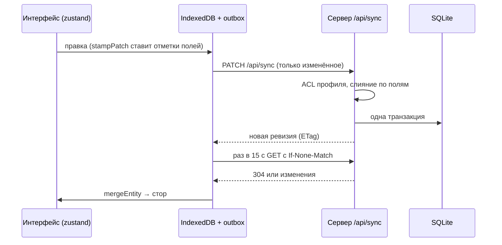

# Архитектура «Поры»

Коротко о том, как устроено приложение. Где лежит конкретный код — в [`PROJECT-MAP.md`](PROJECT-MAP.md), почему выбрано именно так — в [`DECISIONS.md`](DECISIONS.md), установка на NAS — в [`SYNOLOGY.md`](SYNOLOGY.md).

## Компоненты

| Часть | Технология | Где |
| --- | --- | --- |
| Сборка | Vite 8 | `vite.config.ts` |
| Интерфейс | React 19, Tailwind CSS 4, дизайн-токены | `src/components`, `src/tokens.css` |
| Маршруты клиента | TanStack Start / Router | `src/routes` |
| Сервер | Nitro 3 (beta), пресет `node-server` | `server/` |
| Состояние на клиенте | zustand 5 с `persist` | `src/lib/planner-store.ts` |
| Хранилище на сервере | SQLite (better-sqlite3, WAL) в `DATA_DIR/pora.db` | `server/lib/db` |
| Локальная копия | IndexedDB + service worker | `src/lib/offline` |

В `npm run dev` работает только клиент. Nitro подключается при `vite build` и `vite preview`, и сборка даёт `.output/server/index.mjs`.

## Данные

- **Модель.** Один документ синхронизации на сервер, коллекции `lists`, `tasks`, `habits`, `milestones`, `projects`, `assets`, плюс настройки и надгробия (tombstones) для каждого пользователя. Каждая сущность хранит отметки времени по полям: `_b` (создание), `_f` (поле → время правки), `_s` (поле → время последнего изменения у части данных), `_d` (удаление) (`src/lib/sync/merge.ts`).
- **Хранение.** С 1.12.0 сущности и их части лежат в таблицах SQLite (`server/lib/db/doc-tables.ts`), отметки сохраняются без изменений. Версии схемы ведёт `schema_migrations` (`server/lib/db/schema.ts`): v1 — 1.12.0, v2 — `quick_tokens` (1.13.0), v3 — `helper_keys` и `helper_audit` (1.25.0). Для старых установок остался запасной режим JSON. Старые JSON-файлы 1.11 импортируются один раз, со сверкой.
- **Снимки.** Плагин `db-snapshots` раз в сутки делает `VACUUM INTO backup/pora-<дата>.db` и хранит 7 последних. Ручные копии и откат делают скрипты `scripts/db-snapshot.mjs`, `restore-backup.mjs`, `db-downgrade-*.mjs`.

## Синхронизация



- Устройство правит локальную копию сразу. Отметки ставит `src/lib/planner/stamp.ts` по часам, поправленным по серверу (`sync/clock.ts`).
- `sync/engine.ts` делает один прогон: отправляет очередь, затем делает условный GET. Конфликты решаются по полям, побеждает более поздняя правка поля, поэтому одновременные правки разных полей не теряются.
- Без сети правки копятся в очереди (`offline/outbox.ts`) и уходят сами, с повторами.
- Сервер не доверяет клиенту: `server/lib/sync-store.ts` применяет данные через представление пользователя (`sync/world.ts`, `server/lib/sync-access.ts`).
- Правки, которые делает сам сервер (помощник, быстрое добавление, ключи помощника), идут через `editEntity` с теми же отметками и попадают на устройства обычной синхронизацией.

## Вход и сессии

- Вход по паролю из `.env`: `APP_PASSWORD` / `APP_PASSWORD_HASH`, или несколько профилей через `APP_USERS` и `USER_<LOGIN>_PASSWORD[_HASH]`. Если пароля нет, сервер закрыт: работают только `/api/health` и статика.
- Сессия — cookie с токеном `v3`, подписанным HMAC-SHA256 (`SESSION_SECRET` плюс отпечаток пароля). Неактивная сессия живёт 30 дней, максимум — 90 дней с ввода пароля. «Выйти на всех устройствах» и смена пароля сдвигают эпоху и отзывают сессии, ключи быстрого добавления и ключи помощника.
- `server/middleware/01.auth.ts` пропускает без сессии только публичные пути и два вида запросов по ключу (Bearer): `POST /api/quick-add` и `/api/helper/*`. Кроме того, он проверяет, что запросы с изменениями пришли с того же сайта, а неудачные входы ограничены.
- `00.guard.ts` ставит заголовки безопасности (CSP и другие), сжимает ответы (br/gzip) и превращает необработанную ошибку в чистый 500 с одной строкой в журнале.

## Профили и совместная работа

Все профили одного сервера делят один набор сущностей. У каждой сущности есть `owner`. `members` делает её совместной, `assignee` назначает задачу. Пользователь видит только то, что ему доступно, у него своя ревизия и свои надгробия. Изменить `owner` нельзя. Если доступ потерян, сущность исчезает у этого пользователя. Подробности — в шапке `src/lib/sync/world.ts`.

## Помощник (AI)

- Сервер (`server/lib/ai`) перебирает модели по очереди: ПК в домашней сети, затем бесплатные облачные модели, платная последней. При ошибке или лимите следует пауза для этой модели и переход к следующей, расход токенов ограничен месячным потолком.
- Модель отвечает текстом и предложениями, контекст ограничен данными вошедшего профиля. Изменения применяются только после «Применить» на клиенте (`src/lib/assistant`).
- Вопросы, заданные без сети, сервер обрабатывает позже (`server/plugins/assistant-queue.ts`). Без настроенных моделей помощник выключен.

## Быстрое добавление и ключи помощника

- **Ключи устройств** (1.13.0). Отдельный ключ на каждое устройство, на сервере хранится только хэш. Ключ умеет только `POST /api/quick-add` (текст, ссылка, фото во «Входящие»), у него есть лимиты. Таблица `quick_tokens`.
- **Ключи помощника** (1.25.0–1.26.0). Ключ для бота или скрипта с HTTP API `/api/helper/*` ([`HELPER-API.md`](HELPER-API.md)). Ключ создаёт задачи и списки, читает и правит только свои записи, удалять не может. У каждого действия есть лимиты по видам, всё пишется в журнал `helper_audit`. Ключи и журнал видны в «Настройки → Помощники».

## Напоминания (push)

Web Push по стандарту VAPID без сторонних библиотек (`server/lib/push`). Ключи VAPID задаются только в `.env` (создать их можно скриптом `scripts/push-keys.mjs`); без ключей напоминания выключены, остальное работает. Плагин `push-scheduler` раз в 30 с собирает наступившие напоминания по подпискам каждого профиля. На устройстве уведомления показывает service worker (`scripts/sw-template.js`).

## Вложения

Файлы лежат в `DATA_DIR/attachments`. Тип определяется по содержимому, HEIC переводится в JPEG, фото сжимаются на устройстве, время съёмки берётся из EXIF для подписи, доступ проверяется по правам на задачу. Файлы удалённых задач плагин `attachments-cleanup` убирает раз в 6 часов.

## Поток данных целиком

```mermaid
flowchart LR
  subgraph Устройство
    UI[React + zustand] --> OB[IndexedDB / outbox]
    SW[service worker] --- UI
  end
  OB -- HTTPS --> RP[Обратный прокси NAS]
  Bot[Бот с ключом помощника] -- HTTPS --> RP
  Phone[Быстрая команда iPhone] -- HTTPS --> RP
  RP -- 127.0.0.1:8080 --> APP
  subgraph APP[Контейнер pora-app]
    MW[00.guard → 01.auth] --> R[/api/*]
    R --> ST[sync-store / helper / quick-add / ai]
    ST --> DB[(SQLite pora.db)]
    PL[плагины: push, снимки, очистка, очередь] --> DB
  end
  ST -- запросы к моделям --> AI[Модели помощника]
```

## Сборка и выпуск

- `.github/workflows/docker-ghcr.yml`: на каждый PR и push в `main` выполняются проверки (`npm ci`, `typecheck`, `test`, `lint`, `brand-check`), затем сборка образа. Только при push в `main` образ публикуется в GHCR (`ghcr.io/<владелец>/<репозиторий>`) с тегами `latest` и `sha-<коротко>`.
- `Dockerfile`: многоэтапная сборка на `node:22-bookworm-slim`, порт 8080, `HEALTHCHECK` на `/api/health`, данные в томе `DATA_DIR=/data`.
- Образ публичный и не содержит секретов.

## Развёртывание на Synology

- В Container Manager создаётся проект `pora` с `compose.yaml` (основа — `docker-compose.ghcr.yml`) и файлом `.env` рядом с ним.
- **Секреты только в `.env` на NAS**: в репозиторий, образ и compose они не попадают.
- Приложение слушает только `127.0.0.1:8080`, снаружи к нему ведёт обратный прокси NAS с HTTPS на адресе вида `pora.example.synology.me`.
- Обновление вручную. Перед ним делается копия `data/`, затем «Остановить» → «Собрать» (или «Обновить» образ → «Запустить»).
- Автообновления и связи между GitHub и NAS нет.
- Пошагово — [`SYNOLOGY.md`](SYNOLOGY.md).
